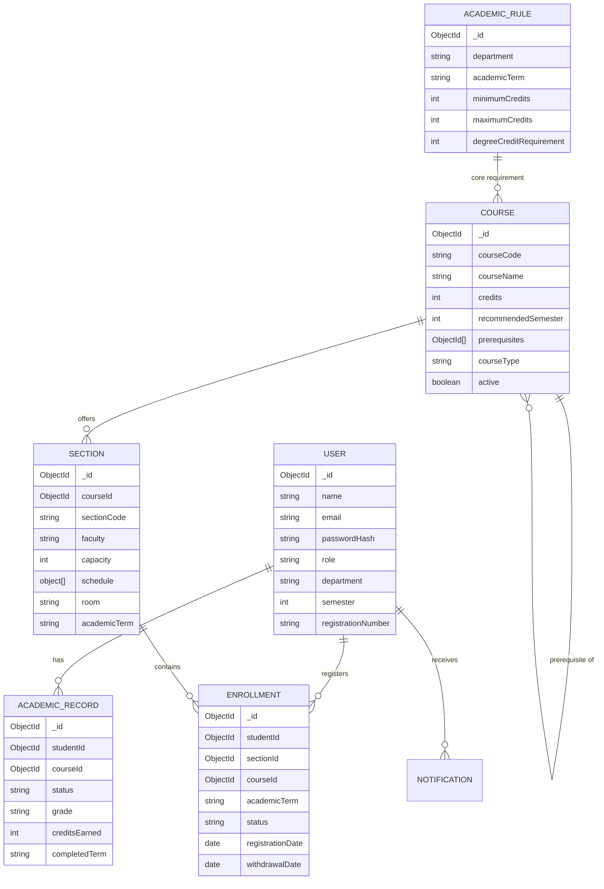

# Smart Course Registration and Academic Planning System
## College Project Review & Architectural Defense Guide

This document is prepared for academic evaluation and technical project defense during a Full Stack Web Development review.

---

## 1. System Overview & Problem Solved

Traditional course registration portals fail students and registrars due to manual verification delays, race conditions during high-volume registration periods, timetable overlaps, and lack of personalized curriculum guidance.

This project delivers a **full-stack MERN solution** featuring:
1. **Automated Server-Side Registration Engine:** Multi-rule evaluation covering prerequisites, schedule collisions, credit limits, seat capacities, and duplicate enrollments.
2. **Deterministic Recommendation Engine:** Rule-based ranking considering student semester standing, unlocked prerequisites, degree requirements, and schedule compatibility without external black-box APIs.
3. **Degree Progress Audit:** Calculates completed credits versus enrolled credits against a degree curriculum.
4. **Interactive Timetable Visualization:** Monday–Saturday schedule grid with conflict-free rendering.
5. **Administrative Telemetry:** Early warnings for near-capacity sections, student transcript management, and curriculum control.

---

## 2. Core Algorithmic Implementations

### A. Timetable Conflict Detection Formula

When evaluating a proposed section meeting against existing registered class meetings on the same day:
- Let the existing meeting interval be $[S_1, E_1)$ in minutes from midnight.
- Let the proposed meeting interval be $[S_2, E_2)$ in minutes from midnight.

A collision exists if and only if:
$$\text{Conflict} = (S_1 < E_2) \land (S_2 < E_1)$$

**Why this formula?**
- Overlapping intervals evaluate to `true`.
- **Adjacent classes** (e.g. Class 1 ends at 10:30 and Class 2 begins at 10:30, so $E_1 = S_2 = 630$) evaluate to:
  $$(S_1 < 630) \land (630 < 630) \implies \text{true} \land \text{false} \implies \text{false}$$
  This permits students to attend back-to-back classes without false-positive conflict rejections.

---

### B. Race Condition & Seat Over-Enrollment Prevention

During high-traffic registration windows, multiple students may simultaneously attempt to claim the final open seat ($N / N$ capacity).

**The Solution:**
1. **Authoritative Database Aggregation:** Active seats are counted directly from confirmed `status: 'registered'` records:
   ```javascript
   const activeCount = await Enrollment.countDocuments({ sectionId, status: 'registered' });
   ```
2. **Compound Unique Partial Index:**
   ```javascript
   enrollmentSchema.index(
     { studentId: 1, courseId: 1, academicTerm: 1 },
     { unique: true, partialFilterExpression: { status: 'registered' } }
   );
   ```
   This guarantees at the database engine level that no student can acquire two active enrollments for the same course in the same term.
3. **Dual Concurrency Guard:**
   - On replica set or sharded MongoDB clusters: atomic multi-document transactions (`startSession()` and `startTransaction()`).
   - On standalone MongoDB nodes: atomic pre-check + conditional insert + post-insert capacity verification with immediate rollback if capacity is exceeded.

---

### C. Rule-Based Course Recommendation Engine

The recommendation engine is 100% transparent and deterministic (no black-box ML):

$$\text{Total Score} = W_{\text{core}} + W_{\text{sem}} + W_{\text{prereq}} + W_{\text{unlock}} + W_{\text{schedule}}$$

- **Core Degree Requirement ($+40$ pts):** Mandatory graduation course.
- **Semester Alignment ($+30$ to $+35$ pts):** Matches the student's current semester or clears lower-semester backlogs.
- **Prerequisite Satisfaction ($+25$ pts):** Rewarded if the student passed all required foundational courses.
- **Unlocks Future Courses ($+20$ pts):** Boosts courses that serve as prerequisites for subsequent courses in the curriculum.
- **Conflict-Free Schedule ($+20$ pts):** Boosts courses offering at least one section with open seats that fits into the student's existing weekly timetable.

Each recommendation produces a human-readable explanation string explaining the exact reason for the match.

---

## 3. Database Schema Design & Relationships



---

## 4. Key College Viva / Review Questions & Answers

**Q1: How does the system handle students registering for courses with prerequisites?**
> The backend inspects the student's historical `AcademicRecord` collection where `status: 'completed'` and `grade != 'F'`. If any prerequisite course is missing, the registration engine rejects the request with HTTP 400 and code `PREREQUISITES_INCOMPLETE`, enumerating the exact missing courses.

**Q2: What happens if two students click "Register" for the last available seat at the same time?**
> The registration engine uses authoritative database counting and a transactional rollback guard. The second student's attempt detects the section capacity breach, aborts the insert, releases locks, and returns `SECTION_FULL`.

**Q3: How does the timetable detect conflicts across multiple meetings in a week?**
> Sections can have multiple weekly meetings (e.g. Mon 09:00-10:30 and Wed 09:00-10:30). The engine cross-checks every meeting of the proposed section against every meeting of all currently registered sections for that student. If any meeting shares the same day and satisfies $S_1 < E_2 \land S_2 < E_1$, it reports the exact conflicting course and slot.

**Q4: Can a student exceed the credit limit by registering across different sections?**
> No. The server sums the credits of all active enrollments for that term. If `currentCredits + newCredits > maxCredits`, it rejects registration with `CREDIT_LIMIT_EXCEEDED` regardless of which section was chosen.

**Q5: How does withdrawal maintain system consistency?**
> Course withdrawal does not delete historical records. It updates the enrollment status from `registered` to `withdrawn`, records `withdrawalDate`, and decrements the active registered seat count. The seat is released back to available catalog inventory in real time.
