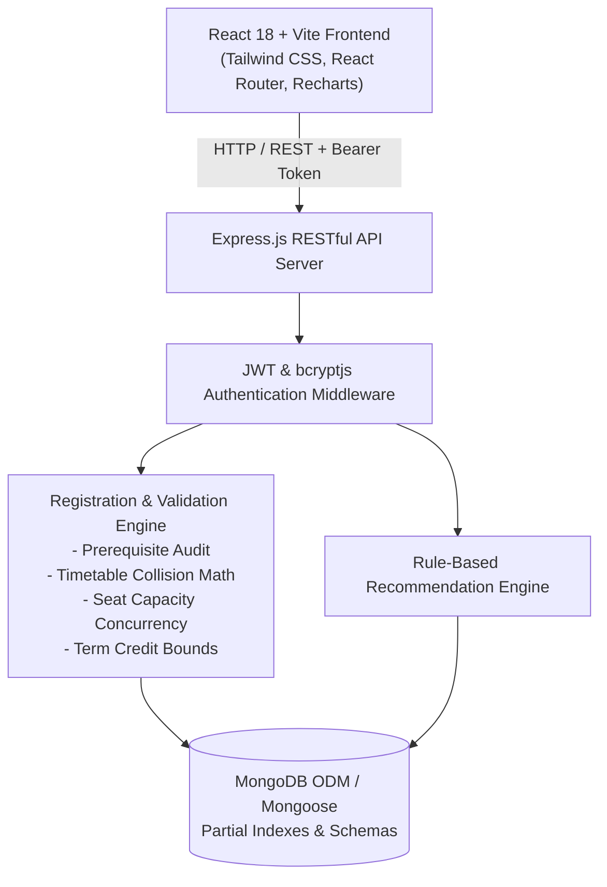

# Smart Course Registration and Academic Planning System

A full-stack MERN (MongoDB, Express.js, React.js, Node.js) web application designed for university academic operations. It eliminates course scheduling conflicts, validates prerequisites and academic credit limits, prevents over-enrollment race conditions, provides visual weekly timetables, tracks degree progress, and generates deterministic rule-based course recommendations.

---

## 1. Project Overview & Problem Statement

Traditional university course registration systems often struggle with:
- **Timetable Clashes:** Students selecting overlapping courses resulting in scheduling conflicts.
- **Prerequisite Failures:** Inability to detect whether prerequisites were passed before registration.
- **Seat Over-Enrollment:** Race conditions when multiple students claim the final remaining seat.
- **Credit Limit Violations:** Students registering beyond permitted term limits or under-enrolling.
- **Degree Planning Blindness:** Lack of visibility into completed versus remaining graduation requirements.
- **Lack of Personalization:** Absence of intelligent, rule-based course matching.

This system provides a unified, role-based platform for **Students** and **Administrators** that addresses every one of these operational hurdles with server-side validation.

---

## 2. System Architecture



---

## 3. Technology Stack

### Frontend
- **Framework:** React.js 18 with Vite
- **Styling:** Tailwind CSS with custom academic palette
- **Icons:** Lucide React
- **Routing:** React Router v6
- **HTTP Client:** Axios with JWT request/response interceptors
- **Data Visualization:** Recharts for administrator enrollment telemetry

### Backend
- **Runtime:** Node.js (ES Modules)
- **Framework:** Express.js
- **Security:** Helmet, CORS, Express-Rate-Limit
- **Authentication:** JSON Web Tokens (JWT) & bcryptjs (10 rounds)
- **Testing:** Native Node.js test runner (`node:test` & `node:assert`)

### Database
- **ODM:** Mongoose v8
- **Database:** MongoDB (Supports standard local MongoDB instance or automated turnkey fallback via `mongodb-memory-server` without manual configuration)

---

## 4. Repository Structure

```
smart-course-registration/
├── client/
│   ├── src/
│   │   ├── components/common/   # Badge, Modal, Alert, Spinner, StatCard
│   │   ├── context/             # AuthContext, NotificationContext
│   │   ├── layouts/             # StudentLayout, AdminLayout
│   │   ├── pages/
│   │   │   ├── auth/            # LoginPage, RegisterPage
│   │   │   ├── student/         # Dashboard, Catalog, Registrations, Timetable, Planner, Notifications, Profile
│   │   │   └── admin/           # Dashboard, Courses, Sections, Enrollments, Students, Rules
│   │   ├── services/            # Axios API client
│   │   ├── styles/              # Tailwind CSS directives
│   │   ├── App.jsx              # Router & role guards
│   │   └── main.jsx             # React entry point
│   ├── index.html
│   ├── tailwind.config.js
│   ├── vite.config.js
│   └── package.json
├── server/
│   ├── config/                  # Database connection with fallback
│   ├── controllers/             # Auth, Course, Section, Enrollment, Academic, Notification, Admin
│   ├── middleware/              # JWT auth guard, role check, error handler
│   ├── models/                  # User, Course, Section, Enrollment, AcademicRecord, AcademicRule, Notification
│   ├── routes/                  # RESTful API route definitions
│   ├── services/                # Registration Engine & Academic Recommendation Engine
│   ├── seed/                    # Comprehensive seed data with 7 demonstration scenarios
│   ├── tests/                   # Automated backend & E2E workflow test suites
│   ├── server.js                # Express application entrypoint
│   └── package.json
├── PROGRESS.md                  # Project milestone tracker
├── PROJECT_EXPLANATION.md       # College viva and architecture explanation guide
├── package.json                 # Monorepo orchestration scripts
└── README.md
```

---

## 5. Demonstration Accounts & Credentials

The seed script creates realistic accounts for immediate evaluation:

| Role | Name | Email | Password | Details |
| :--- | :--- | :--- | :--- | :--- |
| **Student** | Alex Rivera | `alex@student.edu` | `Password123!` | Semester 3, ID: `IT2024-001`, 5 completed courses, 12 registered credits |
| **Student** | Bethany Chen | `bethany@student.edu` | `Password123!` | Semester 3, ID: `IT2024-002`, Registered in full sections |
| **Administrator** | Dr. Eleanor Vance | `admin@university.edu` | `Password123!` | Registrar & Dean, full administrative access |

*Quick Evaluation Feature:* The login screen includes **one-click credential buttons** to instantly populate student or admin accounts without typing.

---

## 6. Installation & Execution Guide

### Prerequisites
- Node.js (v18+ recommended, verified on v24.10)
- npm (v9+, verified on v11.6)
- Windows PowerShell

### Step 1: Install Dependencies
From the root workspace directory, run:
```powershell
npm.cmd run install:all
```
*(Alternatively: `npm.cmd --prefix server install` and `npm.cmd --prefix client install`)*

### Step 2: Seed Demonstration Database
```powershell
npm.cmd run seed
```
This populates 21 courses, 31 sections, 15 students, 1 administrator, academic rules, prerequisites, and all 7 demonstration scenarios.

### Step 3: Run the Application
In separate terminal windows:

**Backend Server (Port 5000):**
```powershell
npm.cmd run server
```

**Frontend Client (Port 5173):**
```powershell
npm.cmd run client
```

Open your browser to: **`http://localhost:5173`**

---

## 7. Automated Test Execution

Run the complete backend test suite across authentication, registration validation, and end-to-end workflows:

```powershell
npm.cmd test
```

### Verified Test Results
```
▶ Authentication & Role-Based Access Control Tests (6 tests passed)
▶ End-to-End User & Administrative Lifecycle Workflow (6 tests passed)
▶ Smart Course Registration Engine & Academic Planning Tests (8 tests passed)
Total: 20 passed, 0 failed, 0 skipped
```

---

## 8. Demonstration Scenarios Walkthrough

| Scenario | Objective | How to Demonstrate in UI | Expected Result |
| :--- | :--- | :--- | :--- |
| **Scenario 1** | **Successful Registration** | Log in as Alex Rivera (`alex@student.edu`). Open Course Catalog. Search `IT204` (Computer Networks). Expand sections and register for `SEC-A`. | Registration is confirmed. Student registered credits increase from 12 to 15. Seat count decrements. Class appears in timetable. |
| **Scenario 2** | **Prerequisites Incomplete** | Search for `IT401` (Distributed Systems) in Course Catalog. Attempt to register. | Backend rejects registration with `PREREQUISITES_INCOMPLETE`. Alert specifies missing `IT204` and `IT205`. |
| **Scenario 3** | **Section Full Rejection** | Search for `IT206` (Web Systems). Section `SEC-FULL` has capacity 2 and is filled by other students. Click register. | Backend rejects registration with `SECTION_FULL`: "Section SEC-FULL has reached its maximum capacity of 2 seats." |
| **Scenario 4** | **Timetable Conflict** | Alex is registered for `IT201 SEC-A` (Mon 13:00–14:30). In catalog, locate `CS102 SEC-A` (also meets Mon 13:00–14:30). Click register. | Backend rejects registration with `TIMETABLE_CONFLICT`: Details the exact day and overlapping time bounds. |
| **Scenario 5** | **Credit Limit Exceeded** | Add multiple courses until reaching 21 credits. Attempt to register for an additional course. | Backend rejects registration with `CREDIT_LIMIT_EXCEEDED` and displays the exact credit breakdown. |
| **Scenario 6** | **Course Withdrawal & Seat Release** | Navigate to "My Registrations". Click "Withdraw Course" on any enrolled course and confirm dialog. | Course status updates to `withdrawn`. Enrolled credits decrease. Seat is immediately released back to catalog inventory. |
| **Scenario 7** | **Rule-Based Recommendations** | Navigate to "Academic Planner" -> "Rule-Based Recommendations". | Displays prioritized course recommendations with transparent rationales explaining completed prerequisites and timetable compatibility. |

---

## 9. Key API Endpoints

### Authentication
- `POST /api/auth/register` — Public student account creation
- `POST /api/auth/login` — Authentication & JWT issuance
- `GET /api/auth/me` — Authenticated profile verification

### Courses & Sections
- `GET /api/courses` — Course catalog with query filters
- `POST /api/courses` — Create course (Admin)
- `PUT /api/courses/:id` — Update course (Admin)
- `DELETE /api/courses/:id` — Deactivate course (Admin)
- `GET /api/sections` — List sections with real-time seat counts
- `POST /api/sections` — Create section with schedule (Admin)
- `PUT /api/sections/:id` — Update section & safe capacity validation (Admin)

### Registration Engine
- `GET /api/enrollments/check-eligibility?sectionId=...` — Real-time validation audit
- `POST /api/enrollments` — Register for course section
- `DELETE /api/enrollments/:id` — Withdraw from registered course
- `GET /api/enrollments/me` — Student's active enrollments

### Academic Planning & Recommendations
- `GET /api/academic/progress` — Degree progress, credits, curriculum audit
- `GET /api/academic/recommendations` — Rule-based recommendation ranking
- `GET /api/academic/timetable` — Monday–Saturday conflict-free schedule grid

### Administration
- `GET /api/admin/dashboard` — University enrollment statistics and telemetry
- `GET /api/admin/students` — Student list and standing
- `GET /api/admin/students/:id/academic-records` — Student transcript
- `POST /api/admin/academic-records` — Add/update student completed grade record
- `GET /api/admin/rules` & `PUT /api/admin/rules/:id` — Manage academic policies
